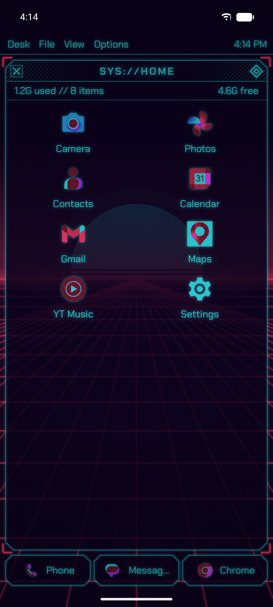
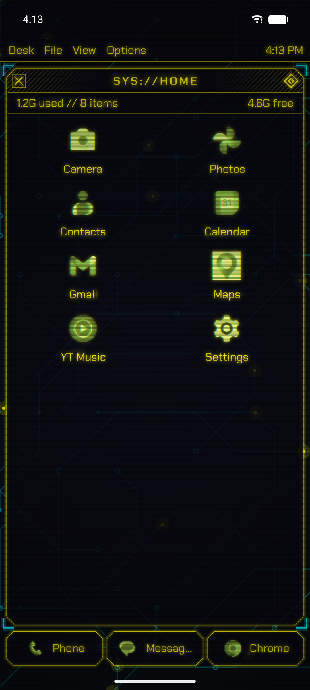
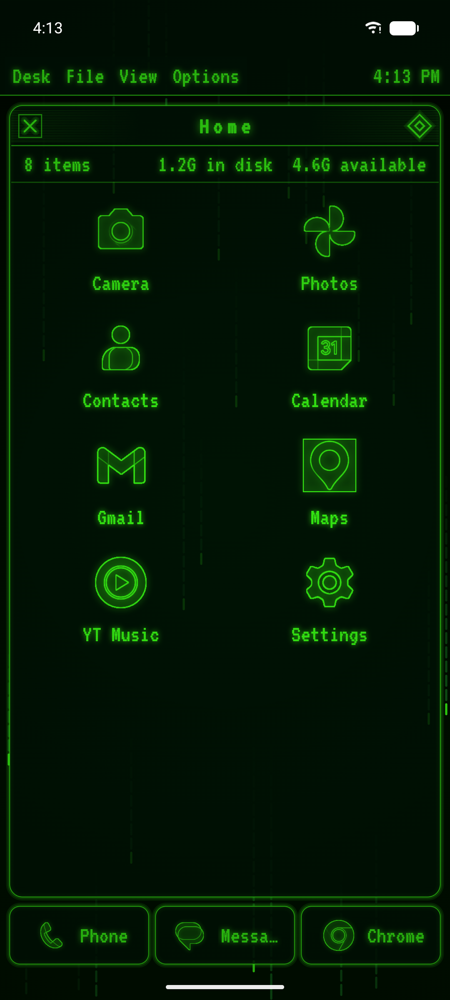
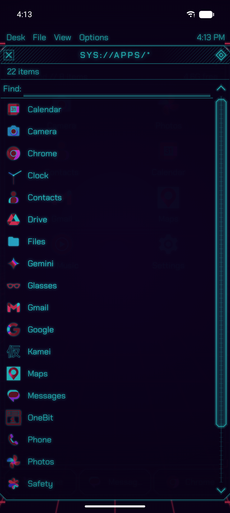

# HyperBit Launcher

**What if the retro desktop had an ultra-HD screen? Neon glass windows over animated backdrops.**

HyperBit keeps the classic desktop layout (menu bar, paged home window, taskbar, app list) and redraws it retro-futuristic: glowing neon outlines on glass, a synthwave sun over a scrolling grid, circuit traces, digital rain, scanlines. Icons get the same treatment: neon duotone, hologram or wireframe.

<p>




</p>

## Features

- **Neon desktop.** Glass windows with neon edges and glow, bracket or scanline window styles, a menu bar and info line, real pages with a scroll bar, drag to move icons.
- **Live backdrops.** Synthwave grid and sun, hex, circuit, rain, dots or plain, animated at 30 fps only while home is visible; optional scanlines and vignette.
- **HD icons.** Neon duotone, hologram, wireframe, glyph (from the app's themed icon), pixel or original, drawn at 192 px with a halo.
- **Presets.** Synthwave, Night city, Vapor, Ghost, Phosphor, Amber, Redline and Ice, or your own neon, glass, backdrop and accent colours.
- **Fonts.** Chakra Petch, Orbitron, Share Tech Mono and VT323.

## Install

- **GitHub:** download `HyperBit-Launcher.apk` from the [latest release](https://github.com/AndSni/HyperBit-Launcher/releases/latest) and open it
  (allow "install unknown apps"). Then press Home and pick HyperBit.
- **F-Droid:** not submitted yet.

Requires Android 8.0 (API 26) or newer.

## Privacy

HyperBit has no internet permission: it cannot connect anywhere. No account, no analytics, no ads, no tracking.

| Permission | Used for |
|---|---|
| Expand status bar | swipe down opens the notification shade |
| Request delete packages | Uninstall in an app's box |

## Building

```sh
./gradlew :app:assembleDebug        # debug build
./gradlew :app:testDebugUnitTest    # unit tests
```

Release builds are signed by CI from repository secrets; without a `keystore.properties` a
local `assembleRelease` produces an unsigned APK.

## Releasing

1. Bump `versionCode` and `versionName` in `app/build.gradle.kts`; add
   `metadata/en-US/changelogs/<versionCode>.txt`.
2. Commit and push to `main` (CI publishes a rolling `latest` pre-release).
3. Tag that commit `vX.Y.Z` and push the tag: `release-tag.yml` publishes the permanent release
   with `HyperBit-Launcher.apk`, the file `.fdroid.yml`'s `Binaries` points at.
4. Pin the tagged commit's full hash in `.fdroid.yml` (`commit:`), bump `CurrentVersion`.

## Credits

- Fonts: [Chakra Petch](https://fonts.google.com/specimen/Chakra+Petch), [Orbitron](https://fonts.google.com/specimen/Orbitron), [Share Tech Mono](https://fonts.google.com/specimen/Share+Tech+Mono), [VT323](https://fonts.google.com/specimen/VT323) (SIL OFL 1.1)

## License

GPL-3.0. Copyright © 2026 AndSni. Bundled fonts and icons keep their own licences (texts in
`app/src/main/assets/licenses/`).
